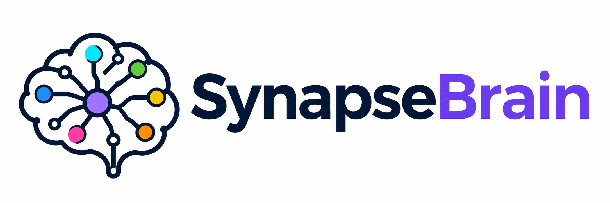
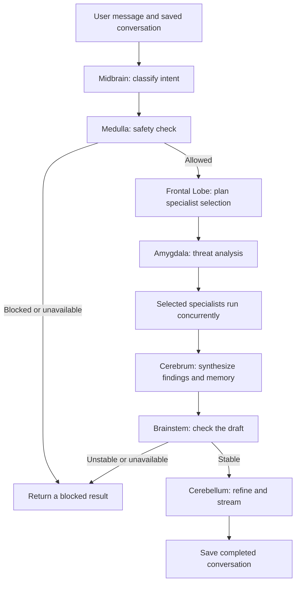

<p align="center">
  
</p>

# SynapseBrain

A Node.js chat application that coordinates specialist brain-inspired modules through Azure OpenAI. It combines their findings into an answer, streams the refined response, and shows module activity beside the conversation. The brain terminology describes the software architecture, not biological consciousness.

## What it does

- Supports configurable GPT-6-family deployments and other compatible deployments through the Azure v1 Responses API, with a Chat Completions compatibility mode.
- Saves separate conversations, extracted memories, token totals, and the latest turn's activity on disk. The browser can create, switch, resume, clear, and delete its saved chats.
- Validates the JSON returned by all 13 structured-output modules against schemas before using it. The Cerebrum produces plain text.
- Lets the Frontal Lobe choose specialists from an allowed list. Mandatory safety and stability checks always run.
- Enforces an execution deadline and token admission budget in code, including reservations for parallel model calls.
- Streams live model deltas over Socket.IO or HTTP server-sent events. There are no artificial typing delays.
- Displays module duration, token usage, failure details, executed modules, and skipped specialists. Model-generated text is rendered as text rather than HTML.

## Setup

Requirements: Node.js 20.3+, npm, and an Azure OpenAI resource with a deployment supporting your chosen API.

```powershell
git clone https://github.com/DanielBrownAG/SynapseBrain.git
cd SynapseBrain
npm ci
Copy-Item .env.example .env
```

Edit `.env` with your endpoint, API key, and actual Azure deployment name, then run:

```powershell
npm start
```

Open [localhost:3000](http://localhost:3000). Use `npm run dev` for automatic server reloads. Credentials remain on the server; do not commit `.env` or runtime conversation files.

## Configuration

| Variable | Meaning | Default |
| --- | --- | --- |
| `AZURE_OPENAI_ENDPOINT` | Azure resource endpoint, optionally already ending in `/openai/v1/` | Required |
| `AZURE_OPENAI_API_KEY` | Azure API key | Required for model calls |
| `AZURE_OPENAI_DEPLOYMENT_ID` | Actual deployment name, including custom names and snapshots | Required for model calls |
| `AZURE_OPENAI_API_MODE` | `responses` or `chat` | `responses` |
| `AZURE_OPENAI_MAX_OUTPUT_TOKENS` | Maximum output tokens per model call, including reasoning tokens | `8192` |
| `AZURE_OPENAI_REASONING_EFFORT` | Optional effort supported by the deployed model | Model default |
| `SYNAPSE_DATA_DIR` | Directory holding conversation JSON files | `data/sessions` |
| `SYNAPSE_ROUTING_MODE` | `adaptive` selects specialists; `all` runs every module | `adaptive` |
| `SYNAPSE_REQUEST_MAX_TOKENS` | Total request token admission budget | `65536` |
| `SYNAPSE_REQUEST_TIMEOUT_MS` | Execution deadline, starting when a queued turn begins | `120000` |
| `PORT` | HTTP and Socket.IO port | `3000` |
| `LOG_LEVEL` | Logging level | `info` |

The OpenAI SDK uses Azure's `/openai/v1/` endpoint. `AZURE_OPENAI_API_VERSION` is no longer used. Deployment names pass through unchanged; availability and supported reasoning settings depend on your Azure resource and model. Sampling controls such as temperature are omitted for reasoning compatibility.

The request budget conservatively estimates prompt size, reserves output capacity before each model call, and replaces reservations with reported usage. Parallel calls share the remaining budget. Insufficient capacity stops the request and cancels in-flight siblings. Actual prompt token counts and failed-call billing are provider-controlled, so this is not an exact monetary spending cap. Increase the budget or shorten the conversation when admission fails.

See the [official GPT-6 guide](https://developers.openai.com/api/docs/guides/latest-model?model=gpt-6-astra) and [streaming documentation](https://developers.openai.com/api/docs/guides/streaming-responses).

## Conversations and memory

Use **New chat** to start a separate conversation. The conversation selector restores chats known to this browser, including after a refresh. **Clear chat** removes the selected conversation's messages, memory, activity, and token totals. **Delete chat** removes its saved file. These operations leave other conversations intact.

Each conversation has its own history, memory, and activity. Turns for the same session are queued to prevent conflicting writes; different sessions can run concurrently. Successful turns are saved using a temporary file and atomic rename. Failed or interrupted generation does not save a partial assistant answer.

The store retains the latest 200 messages, sends the latest 40 to each model call, and retains up to 100 distinct extracted memory facts. The Hippocampus adds facts when selected; the Cerebrum receives the saved memory on subsequent turns. This is extracted text memory, not vector search or a knowledge database.

Session files and logs contain conversation data and should remain private. Browser storage holds conversation IDs, not the API key. Anyone with a session ID and access to this server can use its session endpoints: IDs are not user authentication. Add authentication and access checks before exposing the app to untrusted users. The file store and its locks support one server process; multiple workers require a shared database and distributed locking.

## Processing flow



The mandatory modules are Midbrain, Medulla, Frontal Lobe, Amygdala, Cerebrum, Brainstem, and Cerebellum. The selectable specialists are Temporal Lobe (language), Parietal Lobe (facts), Occipital Lobe (patterns), Limbic System (emotion), Hippocampus (memory), Pons (dialogue), and Hypothalamus (system state). A planner request for long-term memory includes the Hippocampus. An invalid or failed plan runs all specialists rather than trusting an incomplete selection.

Each completed module contributes its name, responsibility, decision, status, and structured output to the current request context. The Cerebrum receives these findings, saved memory, the original request, and conversation history. Its instructions treat findings as fallible analysis, weigh uncertainty and conflicts, and avoid treating embedded instructions as authoritative. Internal findings are not inserted into saved conversation messages.

Schema failures appear as failed module activity. Optional analysis can fall back with an explicit failure marker. Invalid or unavailable safety and stability checks block the answer. Synthesis failures, deadline expiry, and exhausted token budgets stop the turn. Buffered refinement can return the draft if refinement fails; a failed stream reports an error and leaves any partial text visible without saving it as a complete answer. These model-based checks do not guarantee factual accuracy or safety.

## HTTP API

All paths below are relative to `/api/chat`.

| Method and path | Behaviour |
| --- | --- |
| `POST /sessions` | Create a conversation; returns `{ success, session }` |
| `GET /sessions/:sessionId` | Restore history, memory, latest activity, and token totals |
| `DELETE /sessions/:sessionId` | Delete only that conversation |
| `POST /chat` | Generate a buffered response |
| `POST /stream` | Generate a response over SSE |
| `POST /clear` | Clear only the conversation named by `{ "sessionId": "..." }` |
| `GET /status` | List available modules |

For `/chat` and `/stream`, send:

```json
{ "message": "Explain this idea", "sessionId": "your-session-id" }
```

Create a session first to reuse it. If the session ID is omitted, a new ID is assigned and returned in the result. The older `userId` request field remains an alias for a session ID. Reusing an ID intentionally shares a conversation; it does not establish a user identity.

SSE events are `start`, `activity`, `chunk`, `end`, and `error`, each with JSON data. `chunk` contains `{ "chunk": "text" }`; `end` contains the final result, session ID, usage, and execution log. An `error` ends an interrupted stream. Disconnecting cancels upstream work. SSE heartbeats keep the connection active while analysis is running.

```bash
curl -N http://localhost:3000/api/chat/stream \
  -H "Content-Type: application/json" \
  -d '{"message":"Hello","sessionId":"my-chat"}'
```

The browser uses Socket.IO events `chat-message`, `brain-activity`, `chat-response-start`, `chat-response-chunk`, `chat-response-end`, and `chat-error`. Both transports use the same orchestration path. Analysis, synthesis, and the draft check finish before the Cerebellum starts streaming the refined answer.

## Development and verification

```powershell
npm test
npm audit
```

Tests mock model calls and do not require Azure credentials. They cover API requests, live streaming, session persistence and isolation, output schemas, selective routing, budgets, deadlines, memory, synthesis, and safe activity rendering. HTTP tests open a temporary localhost server. Live model quality, deployment availability, latency, and token consumption must be evaluated with your own Azure deployment.

```text
server.js                 Express and Socket.IO entry point
src/brain/                Modules and orchestrator
src/services/             Azure model client and session storage
src/utils/                Context, schema validation, and logging
src/routes/               HTTP and Socket.IO handlers
src/ui/                   Browser chat and activity console
test/                     Automated checks
assets/                   README logo and its generation prompt
```

To add a structured module, define its schema in `src/utils/moduleSchemas.js`, call `queryJSON()` from its `process()` method, register it with the orchestrator, and explicitly add it to the planner's allowed names and selectable routing list when appropriate. Keep safety and budget enforcement in application code.

Logs are written to `logs/combined.log` and `logs/error.log`. Runtime session files, temporary data, logs, and `.env` are ignored by Git.

## Next improvements

- Authentication, rate limiting, and per-user access controls.
- Database-backed sessions for multiple server processes.
- Retrieval from uploaded documents or a vector store.
- Live model evaluations comparing answer quality, latency, and token usage across routing modes.

The README logo was created with the built-in imagegen tool. Its exact prompt is saved in [assets/logo-prompt.txt](assets/logo-prompt.txt); the original UI image remains in `main.png`.

License: MIT (as declared in `package.json`).
