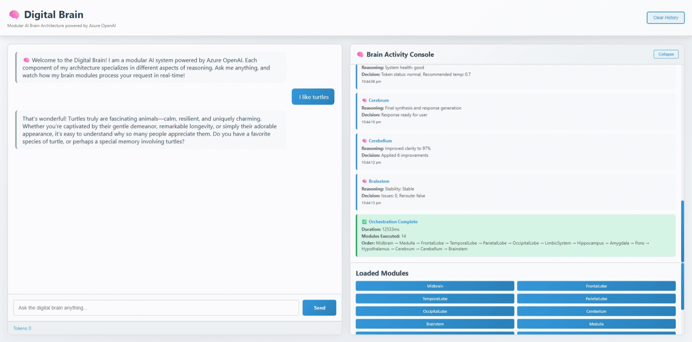
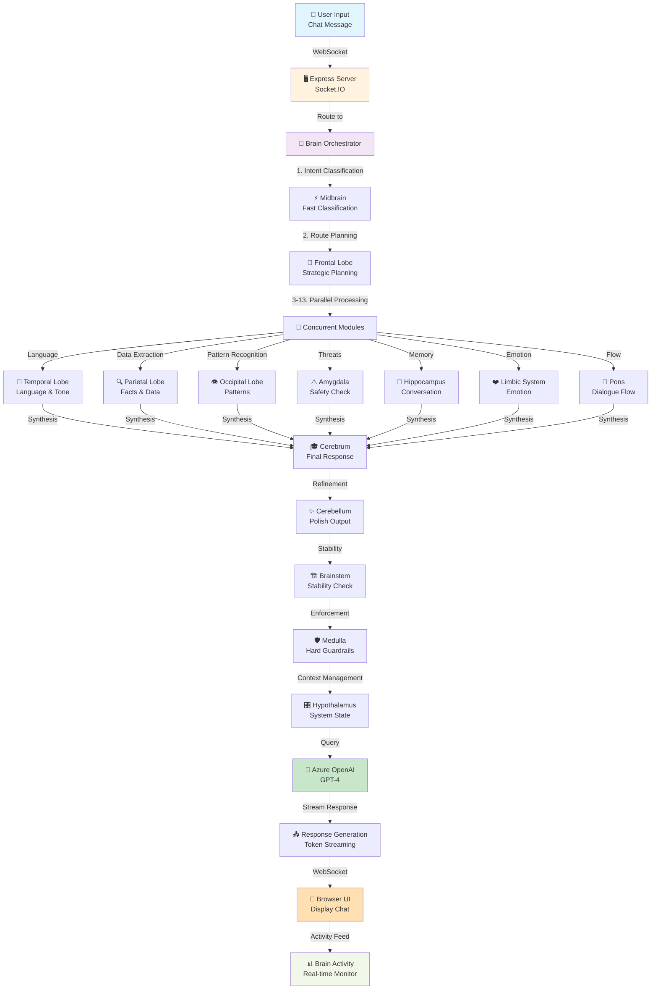

# 🧠 SynapseBrain - Modular Azure OpenAI Orchestrator



A production-grade Node.js web application that simulates a modular human brain architecture for orchestrating Azure OpenAI conversations.

## Overview

SynapseBrain represents a fully-functional AI consciousness with independent brain modules, each with specialized responsibilities:

- **Midbrain**: Fast intent classification
- **Frontal Lobe**: Strategic planning and module routing
- **Temporal Lobe**: Language understanding and tone detection
- **Parietal Lobe**: Data extraction and fact interpretation
- **Occipital Lobe**: Pattern recognition
- **Cerebellum**: Output refinement and clarity
- **Brainstem**: System stability assurance
- **Medulla**: Safety enforcement and hard guardrails
- **Amygdala**: Threat detection
- **Hippocampus**: Memory persistence
- **Hypothalamus**: System state management
- **Limbic System**: Emotional interpretation
- **Pons**: Dialogue flow management
- **Cerebrum**: Final synthesis and response generation

## Architecture

```
/src
  /brain              - All brain modules
  /services          - External service integrations (Azure OpenAI)
  /routes            - API endpoints
  /ui                - Frontend application
  /middleware        - Express middleware
  /utils             - Shared utilities
server.js           - Main Express/Socket.io server
```

### Process Flow



## Features

- ✅ **Modular Brain Architecture** - 14 independent brain modules with specialized responsibilities
- ✅ **Real-time Activity Streaming** - Watch brain modules process in real-time via WebSocket
- ✅ **Azure OpenAI Integration** - Seamless GPT-4 integration with streaming support
- ✅ **Orchestration Engine** - Central orchestrator that routes between modules
- ✅ **Safety Enforcement** - Multiple safety layers (Medulla, Brainstem, Amygdala)
- ✅ **Memory Management** - Hippocampus for conversation persistence
- ✅ **Token Tracking** - Real-time token usage monitoring
- ✅ **Production-Ready** - Clean architecture, error handling, logging
- ✅ **Split-Screen UI** - Chat on left, brain activity on right
- ✅ **Extensible** - Easily add new brain modules

## Installation

### Prerequisites
- Node.js 18+ (LTS)
- Azure OpenAI account with GPT-4 deployment
- npm or yarn

### Setup Steps

1. **Clone or Create Project**
```bash
cd d:\Code\Brain
```

2. **Install Dependencies**
```bash
npm install
```

3. **Configure Environment**
Create `.env` file:
```env
AZURE_OPENAI_ENDPOINT=https://your-resource-name.openai.azure.com/
AZURE_OPENAI_API_KEY=your-api-key-here
AZURE_OPENAI_DEPLOYMENT_ID=gpt-4
AZURE_OPENAI_API_VERSION=2024-02-15-preview
PORT=3000
NODE_ENV=development
LOG_LEVEL=info
```

4. **Create Logs Directory**
```bash
mkdir logs
```

5. **Start Server**
```bash
npm start
```

or for development with auto-reload:
```bash
npm run dev
```

6. **Access Application**
Open browser: `http://localhost:3000`

## Usage

### Web Interface

1. **Chat Panel (Left)**
   - Type your message in the input field
   - Press Enter or click Send
   - View AI responses in real-time

2. **Brain Activity Console (Right)**
   - Watch each brain module activate
   - See reasoning and decision-making
   - View module call chain
   - Monitor token usage

3. **Module List**
   - All 14 brain modules displayed
   - Shows system state

### API Endpoints

**POST `/api/chat/chat`**
Send a message to the brain
```json
{
  "message": "Your question",
  "userId": "optional-user-id"
}
```

**GET `/api/chat/status`**
Get system status and loaded modules

**POST `/api/chat/clear`**
Clear conversation history

## How It Works

### Orchestration Flow

1. **User Input** → Received by orchestrator
2. **Midbrain** → Fast intent classification
3. **Medulla** → Safety check
4. **Frontal Lobe** → Planning and module routing
5. **Parallel Processing** → Temporal, Parietal, Occipital, Limbic, Hippocampus
6. **Amygdala** → Threat detection
7. **Pons** → Dialogue management
8. **Hypothalamus** → System monitoring
9. **Cerebrum** → Final synthesis
10. **Cerebellum** → Output refinement
11. **Brainstem** → Stability check
12. **Response** → Streamed to user

### Brain Module Pattern

Each module follows a strict pattern:

```javascript
async process(input, context) {
  // 1. Log activity
  this.log('Processing input');
  
  // 2. Query LLM with specialized prompt
  const response = await this.queryLLM(input, context.getHistory());
  
  // 3. Parse and validate output
  const result = JSON.parse(response.content);
  
  // 4. Return structured output
  return this.createOutput(reasoning, decision, nextModules, output);
}
```

## Real-Time Streaming

The application uses Socket.IO for real-time brain activity streaming:

```javascript
// Activities streamed to UI as they happen
socket.on('brain-activity', (activity) => {
  // Update UI with module activation
  // Show reasoning and decisions
  // Track module call chain
});
```

## Extensibility

### Adding New Brain Modules

1. Create new file in `/src/brain`:
```javascript
import { BaseBrainModule } from './baseBrainModule.js';

export class MyModule extends BaseBrainModule {
  constructor() {
    super('MyModule', 'Module description');
    this.systemPrompt = `You are...`;
  }

  async process(input, context) {
    // Implementation
  }
}
```

2. Register in orchestrator:
```javascript
// In orchestrator.js registerAllModules()
import MyModule from './myModule.js';
// Add to modules array
```

## Error Handling

The system includes multiple error handling layers:

- **Try-catch blocks** in all modules
- **Fallback responses** for LLM failures
- **Safety validation** before processing
- **System stability checks**
- **Comprehensive logging**

## Logging

Logs are written to:
- `logs/error.log` - Errors only
- `logs/combined.log` - All logs
- Console output - Development

Log format includes:
- Timestamp
- Log level
- Module name
- Detailed message
- Metadata

## Configuration

### Environment Variables

```env
AZURE_OPENAI_ENDPOINT      # Azure OpenAI endpoint URL
AZURE_OPENAI_API_KEY       # Azure OpenAI API key
AZURE_OPENAI_DEPLOYMENT_ID # GPT-4 deployment ID
AZURE_OPENAI_API_VERSION   # API version (default: 2024-02-15-preview)
NODE_ENV                   # development | production
PORT                       # Server port (default: 3000)
LOG_LEVEL                  # debug | info | warn | error
```

### Temperature Control

Managed by Hypothalamus module based on system state:
- Response complexity → Adjusts temperature
- Token usage → Manages budget
- System health → Throttles processing

## Performance

- **Orchestration Time**: Typically 2-5 seconds (depends on Azure OpenAI latency)
- **Parallel Processing**: 5 modules process in parallel
- **Real-time UI Updates**: WebSocket streaming
- **Memory**: ~150MB base + conversation history

## Security

- **API Key Protection**: Environment variables only
- **Safety Enforcement**: Multiple safety layers
- **Input Validation**: All inputs validated
- **No Direct LLM Access**: All calls routed through orchestrator

## Production Deployment

### Considerations

1. **Load Balancing**: Use multiple orchestrator instances
2. **Database**: Add persistent memory with vector embeddings
3. **Monitoring**: Integrate with Application Insights
4. **Rate Limiting**: Implement per-user rate limits
5. **Authentication**: Add user authentication
6. **Caching**: Cache module responses
7. **CDN**: Serve static UI from CDN

### Scaling

For production, consider:
- Redis for distributed memory
- Azure Queue for async processing
- Azure Cosmos DB for persistence
- Azure App Insights for monitoring
- Azure Application Gateway for load balancing

## Troubleshooting

### Issue: "Missing Azure OpenAI credentials"
**Solution**: Ensure `.env` file exists with all required variables

### Issue: LLM responses not valid JSON
**Solution**: Modules include JSON parsing cleanup for markdown code blocks

### Issue: No brain activities showing
**Solution**: Check WebSocket connection in browser DevTools

### Issue: High token usage
**Solution**: Hypothalamus module will flag in logs, reduce conversation history

## Future Enhancements

- [ ] Multi-turn refinement engine
- [ ] Long-term memory with embeddings
- [ ] Custom module trainer
- [ ] Plugin architecture
- [ ] Visualization of neural pathways
- [ ] Performance profiling dashboard
- [ ] A/B testing framework
- [ ] Module confidence scoring

## License

MIT

## Support

For issues or questions:
1. Check logs in `logs/` directory
2. Review error messages in browser console
3. Verify Azure OpenAI credentials
4. Ensure all modules are registered

---

**🧠 Digital Brain** - Where AI Architecture meets Observable Intelligence
